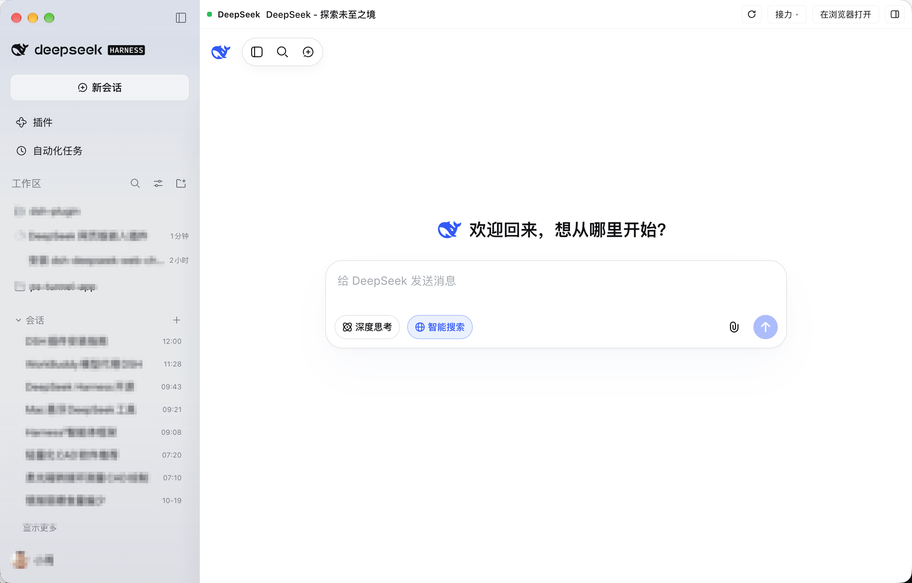
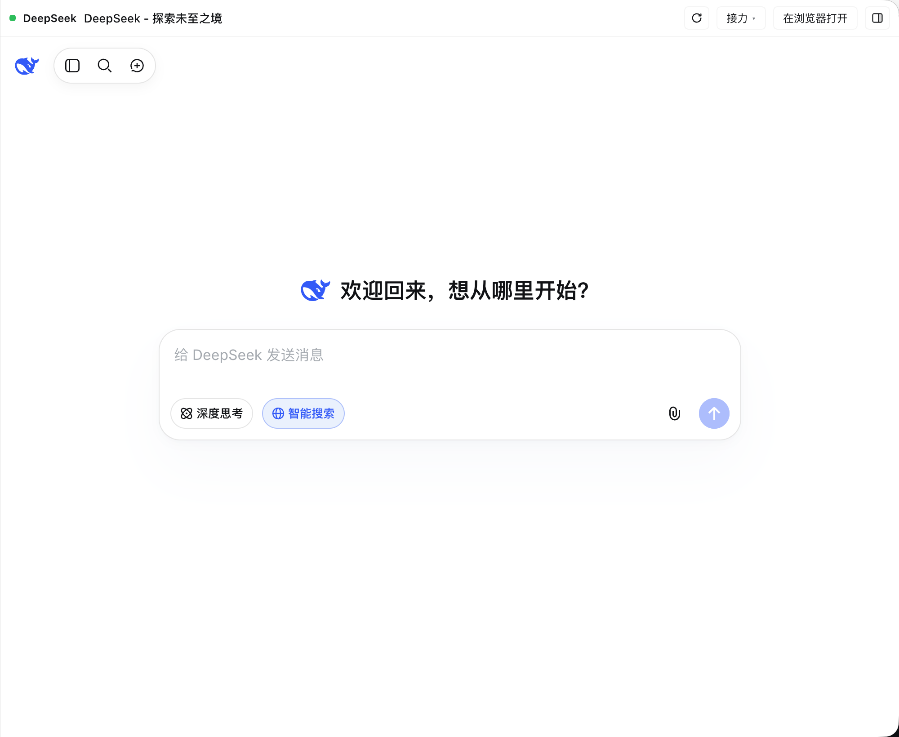

# dsh-deepseek-webdesk

> **DeepSeek 网页工作台 for DeepSeek Harness (DSH)** — 把 DeepSeek 网页版的会话列表搬进 DSH 侧栏，点开就是完整的网页对话，并支持把对话接力到当前任务或新建任务。

[](https://github.com/topics/dsh-plugin)
[](./LICENSE)
[](#开发)



## 它是什么

DSH（DeepSeek Harness）桌面端插件。安装后，左侧栏「工作区」下面会多出一块 **「会话」**，直接列出你 DeepSeek 网页版里的历史会话；点任意一条，主区域打开完整的 `chat.deepseek.com`，并自动跳到那条对话。

不是浮层、不是侧栏面板、也不是新开浏览器——它复用 DSH 自带的内嵌浏览器租约，并把网页登录态一起带过来。

## 功能

- **侧栏会话列表**：网页版历史会话（标题 + 时间），20 秒自动刷新。
  - 悬停行显示 **置顶 / 删除**（与 DSH 工作区会话行同款交互；置顶同步 DeepSeek 云端，删除有确认弹窗）。
  - 点「会话」标题行任意位置折叠/展开；「显示更多」是会话列表内容的最后一行（跟着列表滚动，不固定），每次多加载 20 条。
  - 未登录网页版时列表里显示「未登录，点击登录」按钮；登录态过期（`INVALID_TOKEN`）时显示「登录已过期，点击重新登录」；其他网络/WAF 失败显示「读取失败，点击重新加载」。
- **用量与余额行（可开关）**：左侧栏账号头像/昵称正上方一行：`今日 312M · 总计 312M · 余额 ¥0.98`。
  - token 用量由 Host 半折叠本机全部会话日志得出，口径与对话页右下角用量 pill 一致（含缓存读 token）；悬停看输入/输出/缓存读/合计明细，点一下立即刷新，60 秒自动刷新。
  - 余额取自当前 DSH 登录的 DeepSeek 账号（充值余额 + 赠金，按币种展示；悬停看拆分），120 秒自动刷新；**余额低于 ¥1 时数值加粗、低于 ¥0.1 时变红**（token 数值不受影响）。
  - 在 **设置 → 通用 → 侧栏显示用量与余额** 里开关；侧栏收起成 56px 轨道时自动隐藏。
- **完整网页对话**：点会话进入独立 DeepSeek 页，页面铺满主内容区。
  - 顶部是插件自己的头部：`DeepSeek · 当前会话标题` + 刷新 / 接力 / 在浏览器打开 / 右侧栏。
  - 中文界面（DSH 渲染进程默认 `--lang=en-US`，插件会强制 DeepSeek 网页使用 `zh_CN`）。
- **自带登录态持久化（默认）**：第一次在 DeepSeek 页里正常登录后，插件会把网页的 `localStorage`（含 `userToken`）、可读 cookie 和真实 UA 存到本机 `~/.dsh/deepseek-webdesk/session.json`（权限 600）；之后打开网页、重启 DSH 都会自动装回，**不需要额外插件、也不用反复登录**。
  - 兼容回退：如果本机装了 [`dsh-deepseek-web-login`](https://github.com/cv-superding/dsh-deepseek-web-login) 且还没有自己的快照，会先用它的登录态完成首登，然后自动落盘到上面那份快照。
  - 读会话列表时**优先用自己的快照**（它随页面刷新，是最新 token），快照 token 被站点拒绝后再自动回退到 web-login 账号库。网页端会轮换 `userToken`，账号库里那份过期也不会导致列表一直读失败。
- **接力到 Harness**：两种去向，各支持「最后一条回复 / 整段对话 / 当前一轮问答」：
  - **插入到刚才的任务**：切回原会话，把内容作为草稿插入输入框并聚焦（失败复制到剪贴板）。
  - **新建任务继续**：在当前工作区新建一个 Harness 任务，内容直接填进新任务输入框。
- **单选中态**：进入 DeepSeek 页时工作区会话会取消选中，不会出现两个选中状态；点工作区任务即离开 DeepSeek 页。
- **可拖动窗口**：DeepSeek 页顶部工具条是窗口拖动区域（按住拖动即可移动整个 DSH 窗口）；侧栏「会话」标题行整行可点击收起/展开列表，`＋` 按钮开新对话。
- **全局唤出快捷键（可选附加组件）**：在 **设置 → 通用 → 全局唤出 DSH** 里开启/关闭、点「修改」录制新组合；默认 **macOS `⌥ Space`、Windows `Alt+Space`**。任意页面按一下唤出 DSH，再按一下隐藏。
  - `⌘W` 关掉窗口后也能唤回：助手检测 DSH 是否有可见窗口，没有就用 `dsh://open` 让 DSH 重新创建/聚焦主窗口（已实测）。
  - 实现：插件 Host 会编译并启动一个本地原生小助手（macOS 用 Swift 的 Carbon 全局热键，Windows 用 PowerShell + WinForms 全局热键），由它显示/隐藏整个 DSH 窗口；不需要给 DSH 主程序提权，也不依赖系统“聚焦”功能。
  - 助手二进制只在首次启用时编译到 `~/.dsh/deepseek-webdesk/helper/`（本机），卸载/停用插件后进程退出。



## 安装

需要 DSH 桌面端（>= 0.2.1-rc.2）。

```sh
# 用 DSH 自带 CLI，以 link 方式装进 desktop profile
"/Applications/DeepSeek Harness.app/Contents/Resources/runtime/cli/bin/dsh" \
  plugin --profile desktop add \
  "link:/path/to/dsh-deepseek-webdesk"
```

也可以从 GitHub 安装：

```sh
dsh plugin --profile desktop add github:zneoxlab/dsh-deepseek-webdesk
```

安装完成后重启 DSH（或等插件热加载），左侧栏会出现「会话」。

## 依赖与联动

- **必需**：DSH 桌面端的内嵌浏览器能力（`globalThis.dshDesktop.browser`）。
- **可选**：[`dsh-deepseek-web-login`](https://github.com/cv-superding/dsh-deepseek-web-login) —— 仅作为首次登录态的兜底来源，不是必需依赖。
- 插件 **Host 半** 优先用自己保存的 `~/.dsh/deepseek-webdesk/session.json`，没有时再读 `~/.dsh/web-login/` 的账号；拿到 token 后调用 DeepSeek 官方接口 `chat_session/fetch_page` 拉会话列表，通过同源路由 `/dsh-deepseek-webdesk/api/sessions` 交给客户端。token 只在本机请求头内使用，不打印、不上报。

## 开发

```sh
cd dsh-deepseek-webdesk
npm test        # node --test，Host 映射 + 用量折叠/余额 + 客户端槽位注册
```

文件结构：

| 文件 | 作用 |
| --- | --- |
| `client.js` | 侧栏会话列表、用量与余额行、主区域网页页、内嵌浏览器租约、共享登录、中文强制、接力 |
| `index.js` | Host 半：读网页登录账号、拉取/置顶/删除 DeepSeek 会话列表的 API；折叠会话日志出今日/总计 token 用量；经 DSH 账号服务查 DeepSeek 余额 |
| `cordis.patch.yml` / `package.json` | DSH bundle 与客户端模块清单 |
| `locale/*.json` | 插件管理器中显示的名称与说明 |
| `docs/` | 截图（会话标题已打码） |

## 隐私

- 会话列表与对话内容只在本机 DSH 进程与 DeepSeek 网页之间流转；登录快照只存本机 `~/.dsh/deepseek-webdesk/session.json`（chmod 600）。
- 删除/置顶走 DeepSeek 网页端同款接口，操作的是你自己的账号数据。
- 仓库里的截图已对个人会话标题打码。

## License

[MIT](./LICENSE)

---

<details>
<summary>English</summary>

**dsh-deepseek-webdesk** is a DeepSeek Harness (DSH) desktop plugin that lists your `chat.deepseek.com` conversations in the DSH sidebar and opens the full web chat in the main area. It reuses DSH's embedded-browser lease and the web session captured by `dsh-deepseek-web-login`, forces the Chinese locale, and hands conversations off to the current Harness task or a brand-new one.

</details>
